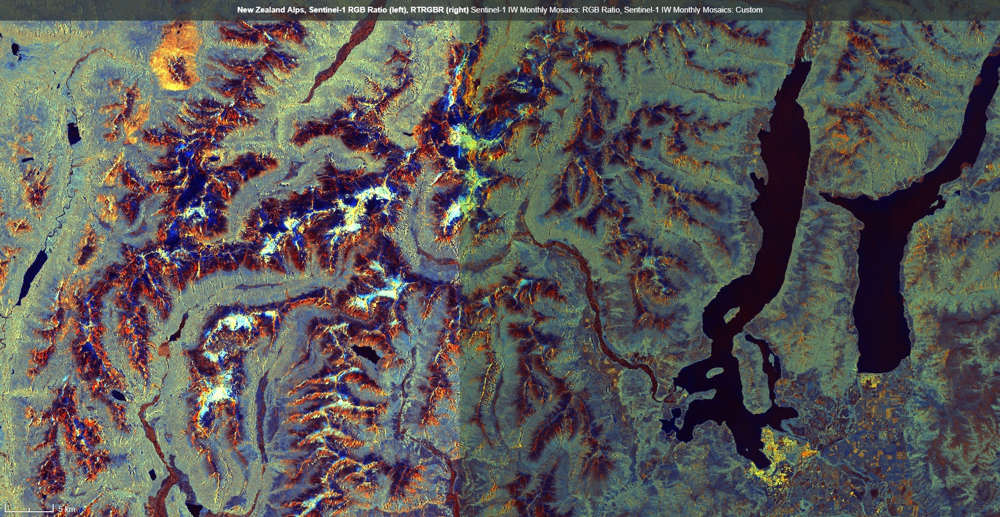
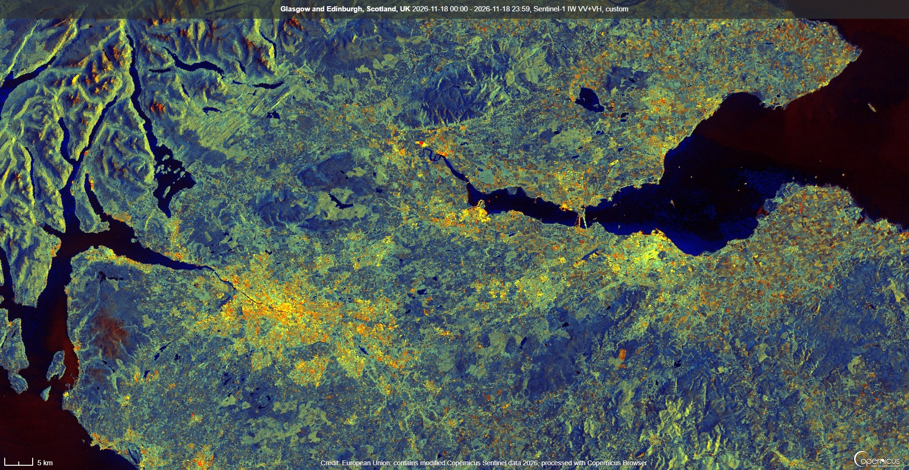

## General description

Reinhard Tonemapped RGB Ratio (RTRGBR) is an adjustment of the default [RGB ratio](/sentinel1-monthly-mosaic/rgb_ratio/) visualisation of Sentinel-1 Synthetic Aperture Radar data. It replaces the linear transfer function with a Reinhard tone-mapping curve, the approach used in the popular [Tonemapped Natural Colour](/sentinel-2/tonemapped_natural_color/) script for Sentinel-2.

As a result, the extremely high and low values are somewhat compressed and the mid-range is lifted. The image is brighter overall: dark areas such as water and bare soil show more pattern, and bright areas such as cities do not wash out to white. The aim is a visually appealing image that is easy to interpret, while the link between the colours and the data stays easy to understand. In that sense it is the radar analogue of [Highlight Optimized Natural Colour](/sentinel-2/highlight_optimized_natural_color/) for Sentinel-2.

The channel assignment follows the standard RGB ratio composite:

- **Red**: VV backscatter (HH in the DH version)
- **Green**: VH backscatter (HV in the DH version)
- **Blue**: the VH/VV ratio (HV/HH in the DH version)

Each channel is multiplied by a gain, with high values applied to green for green vegetation, the colour saturation is boosted slightly, and then each channel passes through the extended Reinhard curve `x / (1 + x) * (1 + 1 / white)` and an optional gamma. Water appears dark, vegetation green, bare ground purple-blue and urban areas yellow-orange, with their internal structure kept.

Three versions are provided:

- `script.js` for Sentinel-1 data with VV+VH polarisation (IW mode GRD and the Sentinel-1 IW monthly mosaic).
- `dh_monthly_mosaic.js` for the Sentinel-1 DH monthly mosaic (HH+HV, polar regions). It uses a slightly stronger mid-tone lift (`gamma = 0.8`) and saturation (`1.2`), and also masks NaN and non-positive pixels so that gaps in the mosaic stay transparent.
- `script_min.js`, a minified copy of `script.js` with the same parameters and output. Copernicus Browser passes custom scripts through the URL of share links, which limits their length; this version is about a fifth of the size.

### Tunable parameters

The top of each script exposes:

- `vvGain`, `vhGain`, `ratGain`: per-channel gains, which set the colour balance and where each channel sits on the tone curve. Raise `vhGain` for greener vegetation.
- `white`: the white point of the Reinhard curve. Higher values leave more headroom for bright targets such as cities.
- `gamma`: values below 1 lift the mid-range further; 1 means no change.
- `saturation`: values above 1 increase colour separation.

## Description of representative images

The Southern Alps of New Zealand west of Wanaka in the Sentinel-1 IW monthly mosaic of September 2026. Left: the standard RGB ratio visualisation; right: RTRGBR. [Open this comparison in Copernicus Browser](https://link.dataspace.copernicus.eu/nvhw).

Glasgow and Edinburgh, Scotland, UK, visualised with RTRGBR in a single Sentinel-1 IW acquisition from 18 November 2026. [Open this scene in Copernicus Browser](https://link.dataspace.copernicus.eu/mtd0).

## References

- [RGB ratio script for the Sentinel-1 monthly mosaic](/sentinel1-monthly-mosaic/rgb_ratio/)
- [Tonemapped Natural Colour script for Sentinel-2](/sentinel-2/tonemapped_natural_color/)
- [Highlight Optimized Natural Colour script for Sentinel-2](/sentinel-2/highlight_optimized_natural_color/)
- Reinhard, E., Stark, M., Shirley, P., Ferwerda, J. (2002). Photographic tone reproduction for digital images. *ACM Transactions on Graphics*, 21(3), 267–276.
