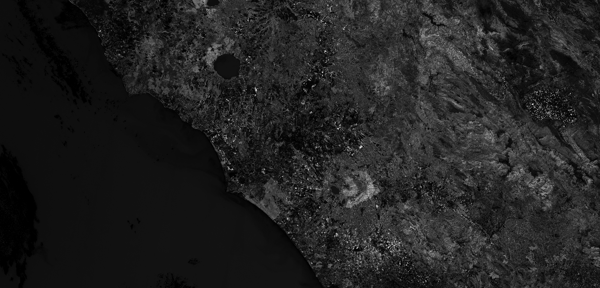

## General description of the script

This visualization estimates canopy chlorophyll content in micrograms per square centimetre of ground area. The legacy URL uses the name `cab`. The neural network already estimates the product of leaf chlorophyll content and leaf area index. See the [S2 Toolbox algorithm specification, section 2.1.4](https://step.esa.int/docs/extra/ATBD_S2ToolBox_L2B_V1.1.pdf).

The script uses a fixed set of [SNAP 2.1 `LAI_Cab` coefficients](https://github.com/senbox-org/s2tbx/tree/33f36f168cf640ca8bcef0a2f7c7aeee906af687/s2tbx-biophysical/src/main/resources/auxdata/2_1/LAI_Cab) with Sentinel-2 L2A reflectances and observation angles. It applies the same coefficients to every acquisition and omits SNAP's input and output validity checks. The display maps 0–300 to black–white.

## Description of representative images

Canopy chlorophyll visualization of Rome. Acquired on 8.10.2017.

