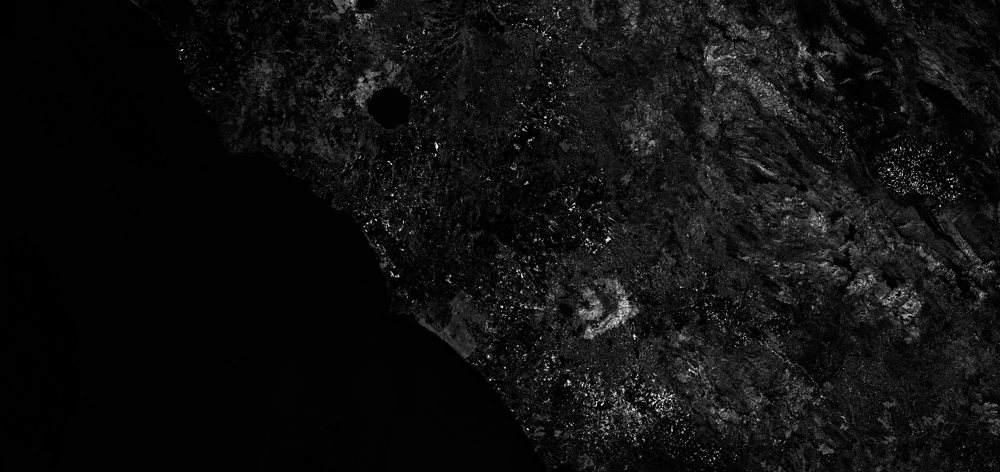

## General description of the script

This script estimates canopy chlorophyll content in micrograms per square centimetre of ground area from Sentinel-2 L2A reflectances and observation angles. The [SNAP 2.1 `LAI_Cab` coefficients](https://github.com/senbox-org/s2tbx/tree/33f36f168cf640ca8bcef0a2f7c7aeee906af687/s2tbx-biophysical/src/main/resources/auxdata/2_1/LAI_Cab) estimate canopy chlorophyll content directly. See the [S2 Toolbox algorithm specification, section 2.1.4](https://step.esa.int/docs/extra/ATBD_S2ToolBox_L2B_V1.1.pdf).

The visualization maps 0–900 to black–white. The script uses the same weights for every acquisition and omits SNAP's input and output validity checks.

## Description of representative images

Historical visualization of Rome, acquired on 8 October 2017. The previous script multiplied the canopy estimate by leaf area index, so its pixel intensities differ from the current output.

